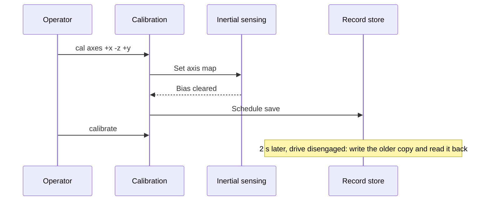

| Field     | Value                      |
|-----------|----------------------------|
| Title     | Runtime Calibration Design |
| Type      | design                     |
| Status    | draft                      |
| Version   | 0.2.0                      |
| Component | calibration                |
| Date      | 2026-11-25                 |

> Lets the operator set the robot's physical calibration from the console, test it at once, and
> keep it across a reset. Until now each value was a constant in the source, so each change
> needed a new build and a flash.

---

## Responsibilities

**Is responsible for:**

- Holding the calibration values and applying them to the components that use them.
- Refusing a change while the drive is armed.
- Saving the values to the EEPROM and restoring them at power-on.

**Is NOT responsible for:**

- Measuring the values: the operator measures them on the bench.
- Control gains: they are tuning (`persistence.md`), not calibration.

---

## Component Details

### Part A — The values

| Value           | Default               | Used by             | Effect                                        |
|-----------------|-----------------------|---------------------|-----------------------------------------------|
| IMU axis map    | identity              | Inertial sensing    | Maps sensor axes and signs to the body frame  |
| Stillness limit | 0.09 rad/s            | Inertial sensing    | Largest rate on any axis that counts as still |
| Upright offset  | 0 rad                 | Attitude estimation | Subtracted from the estimated pitch           |
| Motor sign      | + per wheel           | Motion actuation    | Inverts the effort of one wheel               |
| Encoder sign    | + per wheel           | Wheel odometry      | Inverts the counts of one wheel               |
| Wheel geometry  | 0.034 m, 0.145 m, 1.0 | Wheel odometry      | Wheel radius, track width and gear ratio      |

The board keeps an identity axis map. The calibrated map is applied in inertial sensing, so it is
portable and tested on the host.

### Part B — Applying a change

Each value takes effect at once, so the operator sees its result with the existing commands:
`imu`, `attitude` and `odom`. A change is refused while the drive is armed.

A change to the axis map or the stillness limit makes the gyroscope bias invalid. Inertial sensing
then reports itself uncalibrated, so the robot cannot arm until the operator runs `calibrate`.

The upright offset can be set from a value, or captured: the operator holds the robot upright
and the current estimated pitch becomes the offset. The fall and arming windows of the safety
supervisor then count from the true upright.

### Part C — Console commands

Delivery step 5 adds these commands. `cal` reads each value from its component.

| Command                     | Effect                                                       |
|-----------------------------|--------------------------------------------------------------|
| `cal`                       | Print every value                                            |
| `cal axes +x -z +y`         | Body x, y and z come from these sensor axes with these signs |
| `cal still 0.09`            | Set the stillness limit in rad/s                             |
| `cal upright`               | Capture the current pitch as the upright offset              |
| `cal upright 1.5`           | Set the upright offset in degrees                            |
| `cal motor left -`          | Set the sign of one motor                                    |
| `cal encoder right -`       | Set the sign of one encoder                                  |
| `cal wheel 0.034 0.145 1.0` | Set wheel radius (m), track width (m) and gear ratio         |

### Part D — Persistence

The calibration record uses the tuning record format (`persistence.md`, Part A) with its own
keys. It has two copies of its own at EEPROM offsets 256 and 384, so a calibration save never
touches the tuning copies. The tuning store and the calibration store each have their own
`services::NvmRecordStore` (`persistence.md`,
Part B). The two stores share one EEPROM claim.

The restore applies each stored value through the same setters as the console. A value that a
component rejects keeps its default, and the store reports the restore as corrupt. A missing key
keeps its default. The three axis keys apply together, or not at all. The safety supervisor holds its self-test until the restore
ends (`safety-supervisor.md`, Part F). A restored axis map therefore never interrupts the bias
calibration at power-on.

| Key                       | Value                                                 |
|---------------------------|-------------------------------------------------------|
| `axis.x/y/z`              | Signed sensor axis: ±1, ±2 or ±3 for sensor x, y or z |
| `still`                   | Stillness limit in rad/s                              |
| `upright`                 | Upright offset in rad                                 |
| `motor.left/right`        | −1 when inverted, else +1                             |
| `encoder.left/right`      | −1 when inverted, else +1                             |
| `wheel.radius/track/gear` | Wheel geometry                                        |

Each key is hashed with the strategy name `cal`, as in `persistence.md`, Part A.

---

## Interfaces

### Provided

| Interface          | Purpose                      | Contract                                                      |
|--------------------|------------------------------|---------------------------------------------------------------|
| Calibration access | Set each value               | Writes refused while armed; each component checks its range   |
| Store status       | Restore and last save result | As the tuning store                                           |
| Start-up condition | Restore finished             | Ready once the restore ends, with or without a stored record  |

### Required

| Interface           | Purpose                        | Contract                                   |
|---------------------|--------------------------------|--------------------------------------------|
| Inertial sensing    | Set the axis map and stillness | A change clears the gyroscope bias         |
| Attitude estimation | Set the upright offset         | Applied to every estimate after the change |
| Motion actuation    | Set the motor signs            | Applied to the next effort                 |
| Wheel odometry      | Set encoder signs and geometry | Applied to the next sample                 |
| Balance control     | Read the engagement            | Writes refused while engaged (ARMED)       |
| EEPROM role         | Storage                        | Offsets 256 to 511                         |

---

## Data Model

| Entity    | Field         | Type / Unit    | Range                    | Notes                  |
|-----------|---------------|----------------|--------------------------|------------------------|
| Axis map  | from, sign    | axis index, ±1 | a permutation            | One pair per body axis |
| Stillness | limit         | rad/s          | 0.01 to 1.0              |                        |
| Upright   | offset        | rad            | −0.35 to 0.35            | ±20°                   |
| Motor     | sign          | ±1             | per wheel                |                        |
| Encoder   | sign          | ±1             | per wheel                |                        |
| Geometry  | radius, track | m              | 0.01 to 0.2, 0.05 to 0.5 |                        |
| Geometry  | gear ratio    | ratio          | 0.1 to 100               |                        |

---

## Sequence Diagrams

---

## Constraints & Limitations

| Constraint      | Value / Description                                                     |
|-----------------|-------------------------------------------------------------------------|
| Not while armed | Every change is refused while the drive is armed                        |
| Recalibrate     | An axis map or stillness change needs `calibrate` before the robot arms |
| Storage         | Offsets 256 to 511 of the 24C04; the tuning store keeps 0 to 255        |

---

## Delivery

Five pull requests, each one built and tested on its own:

1. Inertial sensing and attitude estimation: axis map, stillness limit and upright offset setters.
2. Motion actuation and wheel odometry: sign and geometry setters.
3. Persistence: the shared record store, with the tuning store moved onto it.
4. The calibration component, its persistence and the supervisor start-up condition.
5. The `cal` command and the wiring.

---

## Open Questions

| # | Question                                                    | Options                                           | Status |
|---|-------------------------------------------------------------|---------------------------------------------------|--------|
| 1 | Should the board's own axis map be removed once this works? | Keep as identity; remove the constructor argument | open   |
