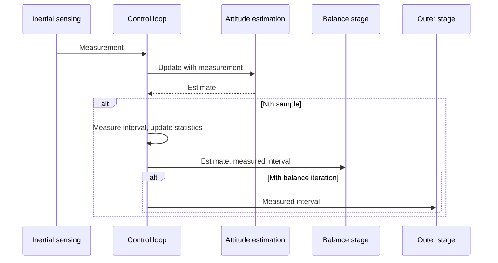

| Field     | Value               |
|-----------|---------------------|
| Title     | Control Loop Design |
| Type      | design              |
| Status    | draft               |
| Version   | 0.3.2               |
| Component | control-loop        |
| Date      | 2026-11-27          |

> Turns a stream of inertial samples into a paced sequence of estimation, balance and outer-loop
> work, and measures how well that pace is kept.

---

## Responsibilities

- Running attitude estimation on every inertial sample.
- Running the balance stage at the balance rate and the outer stage at the outer rate. Both rates
  come from the sample stream rather than from a separate timer.
- Measuring the real interval between balance iterations and handing it to the stage that runs.
- Keeping timing statistics: iterations run, the largest deviation of an iteration's start from its
  nominal period, and the number of late iterations.

---

## Component Details

### Part A — The sample is the clock

The inertial sensor signals data-ready at its own cadence. The latency budget from sample to
actuator is 3 ms. A separate timer would add up to a whole timer period of waiting between a
sample arriving and the loop using it. It would also let the two clocks beat
against each other. The loop is therefore driven by the samples themselves. Every sample is
estimated as it arrives. Every Nth sample also runs the balance stage, with N the ratio of the
balance period to the sample period. At the configured 1 kHz sample rate and 500 Hz balance rate, N is 2.

The outer stage runs every Mth balance iteration, with M the ratio of the outer period to the balance
period — 10 at 50 Hz.

### Part B — Measured intervals, not nominal ones

Each stage receives the interval since its previous run as measured from sample timestamps. The
first run of a stage after start has no previous run and receives the nominal period. A sample
marked invalid still advances the pacing. A missing estimate thus shows up downstream as an invalid
estimate rather than as a silently stretched period.

### Part C — Timing statistics

For every balance iteration after the first, the loop compares the measured interval with the
nominal balance period. The loop keeps the largest absolute deviation seen. An iteration whose interval
exceeds the nominal period by more than the jitter bound (10 percent) counts as late. These
are observations for the operator and the supervisor; the loop itself never skips or reorders work
because of them.

---

## Interfaces

### Provided

| Interface         | Purpose                              | Contract                                                    |
|-------------------|--------------------------------------|-------------------------------------------------------------|
| Timing statistics | Iterations, worst jitter, late count | Updated every balance iteration; resettable by the operator |

### Required

| Interface           | Purpose                             | Contract                                                                                                                                                                        |
|---------------------|-------------------------------------|---------------------------------------------------------------------------------------------------------------------------------------------------------------------------------|
| Inertial sensing    | Per-sample measurement notification | Every sample is delivered once, in order, with its acquisition time; inertial sensing samples the sensor and timestamps each sample                                             |
| Safety supervisor   | Permission and liveness             | Sits in front of both stages and forwards iterations only while ARMED; decides what a late iteration means                                                                      |
| Attitude estimation | Estimate from one measurement       | Returns an estimate with explicit validity for every measurement                                                                                                                |
| Balance stage       | Balance control iteration           | Computes the effort; receives the estimate and the measured interval; bounded execution time; engaged on entry to ARMED so a session starts without history, disengaged on exit |
| Outer stage         | Velocity and yaw iteration          | Receives the measured interval; bounded execution time                                                                                                                          |

---

## Data Model

| Entity     | Field          | Type / Unit  | Range    | Notes                                             |
|------------|----------------|--------------|----------|---------------------------------------------------|
| Pacing     | samplePeriod   | microseconds | 1000     | Set by the inertial sensing configuration         |
| Pacing     | balancePeriod  | microseconds | 2000     | Must be a whole multiple of the sample period     |
| Pacing     | outerPeriod    | microseconds | 20000    | Must be a whole multiple of the balance period    |
| Statistics | iterations     | count        | 0 and up | Balance iterations run                            |
| Statistics | worstJitter    | microseconds | 0 and up | Largest deviation from the nominal balance period |
| Statistics | lateIterations | count        | 0 and up | Intervals longer than the period plus 10 percent  |

---

## Sequence Diagrams

One balance iteration.

---

## Constraints & Limitations

| Constraint           | Value / Description                                                                                                    |
|----------------------|------------------------------------------------------------------------------------------------------------------------|
| Period ratios        | Balance and outer periods must be whole multiples of the sample and balance periods respectively                       |
| Sample-rate coupling | Changing the inertial sample rate changes the pacing ratios; the loop is reconfigured with it                          |
| Event context        | Stages run in the event context that delivers the sample, so a stage that overruns delays the next sample's processing |

---

## Decisions

| # | Decision                                                           | Options                                                    | Status     |
|---|--------------------------------------------------------------------|------------------------------------------------------------|------------|
| 1 | Should the balance stage run from the data-ready interrupt itself? | Event context, as now; interrupt context for lower latency | open (#82) |
