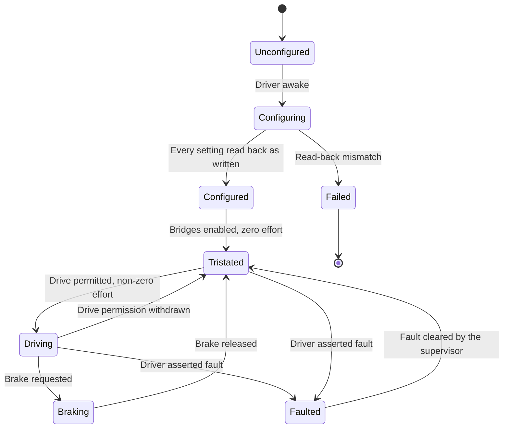
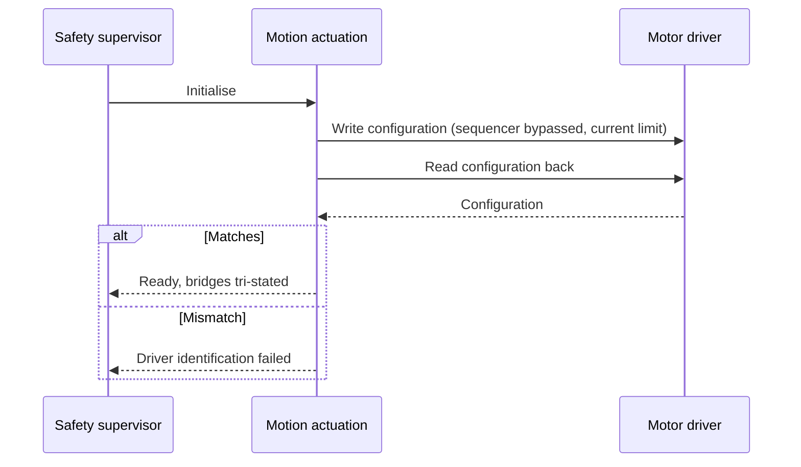
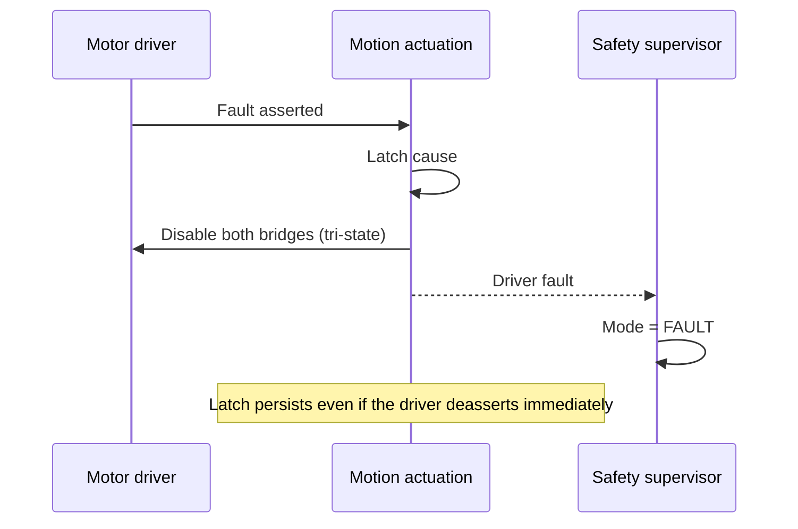
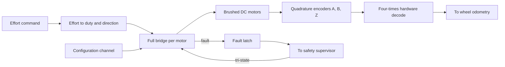

| Field     | Value                   |
|-----------|-------------------------|
| Title     | Motion Actuation Design |
| Type      | design                  |
| Status    | draft                   |
| Version   | 0.3.2                   |
| Component | motion-actuation        |
| Date      | 2026-11-27              |

> Turns an abstract effort command into current through two motors. The one component that
> must always be able to stop, whatever else has failed. What the wheels then did is measured
> by wheel odometry, which is a separate component with its own design document.

---

## Responsibilities

- Configuring the motor driver at startup and verifying the configuration by read-back.
- Driving both full bridges directly, bypassing the driver's internal step sequencer.
- Mapping a signed effort command onto bridge duty cycle and direction.
- Providing tri-state and brake disable states, and guaranteeing the tri-state is always reachable.
- Observing the driver's fault output and reporting it to the safety supervisor.

---

## Component Details

### Part A — One driver, two brushed motors

The motor driver part is nominally a stepper driver. A stepper driver *is* two independent
full H-bridges plus a step sequencer. Bypassing the sequencer and driving the two bridges
directly yields exactly what a two-wheeled balancer needs:

- two independently commanded brushed DC motors,
- per-motor current regulation,
- a single fault output,
- configuration over one serial channel.

The left motor hangs on the first bridge, the right on the second.

The firmware therefore commands bridge state on every control iteration. It does not delegate
it to the part. Each bridge takes **two logic-level inputs**, so one driver needs four lines in
total. All four come from one pulse-width generator on the target, one output per bridge input.
There is no direction pin anywhere. The part generates its own gate drive and its own dead time.
The generator therefore supplies plain logic-level PWM, with no complementary outputs and no
dead-time insertion on the target side.

Putting all four inputs on one generator has three consequences the rest of the design leans on:

- **Both motors switch in phase.** One counter drives every edge, so the two bridges are
  phase-locked, and all four duties are written in one step. The counter runs
  centre-aligned, which halves current ripple against edge alignment at the same switching
  frequency.
- **Direction changes are glitch-free.** Duty updates are buffered, so a new command takes
  effect as a whole at the next period boundary. Reversing a motor swaps which input is held
  and which is switched in one update. No intermediate period applies the old magnitude in the
  new direction.
- **The hardware stop owns every input.** The driver's fault output feeds the generator's
  hardware stop input. A stop forces all four outputs to their idle level, which is low, and
  both inputs low is the tri-state. The release therefore does not depend on the commanded
  direction, on firmware, or on any gate outside the generator.

The decay mode sets which two states a bridge alternates between. It is a firmware choice made
per command, not a wiring choice:

| Decay | Forward effort *e*                    | Reverse effort *e*                        | Off-time state        |
|-------|---------------------------------------|-------------------------------------------|-----------------------|
| Slow  | input 1 held high, input 2 at 1 − *e* | input 1 at 1 − \|*e*\|, input 2 held high | both legs low (brake) |
| Fast  | input 1 at *e*, input 2 held low      | input 1 held low, input 2 at \|*e*\|      | released (tri-state)  |

Slow decay is the default. It keeps the motor current continuous down to small efforts. Torque
therefore stays proportional to effort through the zero crossing a balancer lives around. At zero
effort nothing switches at all. Fast decay lets current collapse during the off-time, which makes
small efforts non-linear. It stays available for comparison on the bench.

### Part B — Configuration and verification

The driver configuration is written during initialisation and read back. It covers:

- control: sense gain, dead time, enable,
- torque: the current-limit setting,
- off-time with the sequencer bypass,
- blanking, decay, stall and gate drive.

Every setting written is read back and compared. The one field the part documents as write-only
is masked. Only when every setting matches are the latched status flags cleared and the enable
bit set. The bridges can only be energised through a configuration that has been verified.

The write, read-back and enable sequence belongs to the driver library, not to this component.
The part answers nothing on a write, so every user of it needs the same check. The library is
where that check is written once. This component only chooses the values: sense gain and torque
from the trip current, dead time, decay. It waits out the part's wake-up time before it asks for
them.

A driver that does not read back what was written is treated as absent, not as merely
misconfigured. Energising motors through a driver in an unknown state is the failure mode this
check exists to prevent. Until configuration completes, and forever after it fails, effort and
brake commands are refused. The tri-state is always accepted.

The current limit is expressed as a trip current. The part trips at a reference voltage times
the torque setting, divided by 256 times the sense gain times the sense resistance. The sense
gain takes the highest of its four values for which the torque setting still fits its eight
bits. That keeps the most resolution. Sense resistance and the motor's continuous rating
are board facts. Until they are known, the configured limit is deliberately conservative.

### Part C — Effort to duty mapping

Effort arrives normalised and signed. Its magnitude selects duty cycle. Its sign selects which
input is switched, per the decay table in Part A. The mapping is monotonic and documented. A
change in commanded effort therefore always produces a change in the same direction at the
wheel. The control strategies rely on this property, and none of them verify it. Duty is carried
at the generator's resolution, not rounded to whole percent.

A motor wired the other way round turns backwards for a positive effort. The operator can invert
each motor's effort at run time ([calibration](calibration.md)). The inversion is off by
default, applies to the next effort, and leaves the tri-state and brake unchanged.

Switching frequency sits above the audible band and is matched to the motor's electrical
time constant. Too low, and the robot whines and the current ripples. Too high, and switching
losses dominate.

### Part D — Tri-state, brake, and why safety uses the tri-state

Tri-stating opens both bridge legs and leaves the motor terminals floating. The robot's wheels
turn freely. Braking shorts the terminals, dissipating kinetic energy and resisting motion.

Both states are reached through the same two inputs, and the encoding is easy to get
backwards. Driving both inputs low is a *tri-state*, not a brake:

| Input 1 | Input 2 | Bridge         | Meaning   |
|---------|---------|----------------|-----------|
| low     | low     | released       | Tri-state |
| high    | low     | driven forward | Forward   |
| low     | high    | driven reverse | Reverse   |
| high    | high    | both legs low  | Brake     |

Safety-initiated disables always tri-state. A falling robot that brakes plants its wheels and
converts a topple into a harder impact. Braking also still drives current through the bridges
at the moment a fault is suspected. The hardware also reaches the tri-state without firmware
cooperation. That makes it reachable when the control loop is already gone. A brake requested while a fault is latched is refused for the same reason.

### Part E — Encoder decoding is configured here and consumed elsewhere

A hardware counter decodes each encoder's A and B channels in four-times quadrature. It counts
every edge on both channels for maximum resolution. Configuring those counters is part of
bringing up the platform. It is described here, beside the counter budget it competes for.

Two decisions made at that configuration are contracts the wheel odometry component relies on
and must not repeat. The counter resolution bounds the wrap that odometry reconstructs. The two
wheels are mirrored physically, so one encoder is configured with an inverted phase. Both then
count up for forward robot motion. Odometry applies no sign correction unless the operator sets
one ([wheel odometry](wheel-odometry.md), Part E).

Everything past the counter belongs to the wheel odometry component: accumulation across wrap,
wheel velocity, chassis motion. The [wheel odometry design](wheel-odometry.md) describes it.

---

## Interfaces

### Provided

| Interface          | Purpose                                 | Contract                                                                                    |
|--------------------|-----------------------------------------|---------------------------------------------------------------------------------------------|
| Effort application | Apply a signed effort to each motor     | Monotonic mapping to duty and direction; ignored unless the drive is permitted              |
| Drive disable      | Tri-state or brake both bridges         | The tri-state must succeed without a healthy control loop; safety disables always tri-state |
| Driver health      | Report driver-asserted faults           | Latched on assertion, even if the condition clears immediately                              |
| Motor inversion    | Invert the effort of one motor          | Off by default; applies to the next effort                                                  |
| Wheel encoders     | Access to both decoded encoder counters | Already sign-corrected for the mirrored mounting; consumed by wheel odometry                |

### Required

| Interface                    | Purpose                                  | Contract                                                         |
|------------------------------|------------------------------------------|------------------------------------------------------------------|
| Driver configuration channel | Write and read back driver configuration | Read-back mismatch is a fatal startup condition                  |
| Bridge control outputs       | Duty on both inputs of each bridge       | One generator, phase-locked, released by the hardware stop input |
| Driver fault input           | Observe the driver's fault assertion     | Observable without polling the configuration channel             |
| Encoder channel inputs       | A, B and index per wheel                 | Decoded without losing edges at maximum wheel speed              |

Boundaries with the neighbouring components:

- Wheel odometry measures what the wheels did: wheel position, wheel velocity and chassis
  motion. This component allocates the encoder counters, fixes the sign convention, and stops
  there.
- Balance control and the safety supervisor decide what effort to apply and whether the drive
  may be energised.
- The safety supervisor interprets a fault. This component only latches and reports it.
- Attitude estimation estimates body attitude.
- Balance control closes the outer loops. Effort maps to duty open-loop. No current or velocity
  loop closes around the motors here.

---

## Data Model

| Entity        | Field                 | Type / Unit       | Range                                   | Notes                                      |
|---------------|-----------------------|-------------------|-----------------------------------------|--------------------------------------------|
| Command       | left and right effort | normalised effort | -1.0 to 1.0                             | Sign selects direction                     |
| Command       | disable state         | enumeration       | Tri-state, Brake                        | Safety paths use the tri-state exclusively |
| Encoder       | counts per revolution | counts            | fitted value                            | Four times the encoder line count          |
| Configuration | current limit         | amperes           | at or below the motor continuous rating | Verified by read-back                      |
| Configuration | switching frequency   | kilohertz         | above 20                                | Above the audible band                     |
| Configuration | sense resistance      | milliohms         | fitted value                            | Board fact; sets the current-limit scale   |
| Configuration | decay                 | enumeration       | Slow, Fast                              | Slow by default                            |

---

## State Machine

---

## Sequence Diagrams

Startup configuration.

A driver fault during flight.

---

## Block Diagram

---

## Constraints & Limitations

| Constraint              | Value / Description                                                                                                                    |
|-------------------------|----------------------------------------------------------------------------------------------------------------------------------------|
| Tri-state reachability  | Tri-stating must not depend on the control loop, the estimator or the link                                                             |
| Configuration trust     | An unverifiable driver configuration prevents startup rather than degrading operation                                                  |
| Switching frequency     | Above 20 kHz and compatible with the motor electrical time constant                                                                    |
| Current limit           | At or below the continuous rating of the fitted motors                                                                                 |
| Open-loop torque        | Effort maps to duty, not to current. Torque per unit effort varies with battery voltage and motor speed; the balance loops absorb this |
| No battery compensation | A discharging battery reduces the effort actually delivered; not compensated in this revision                                          |

---

## Decisions

| # | Decision                                                                                                              | Options                                                           | Status                                                                                                  |
|---|-----------------------------------------------------------------------------------------------------------------------|-------------------------------------------------------------------|---------------------------------------------------------------------------------------------------------|
| 1 | Should effort compensate for measured battery voltage so torque per unit effort stays constant as the battery drains? | Leave to the balance loops; add feed-forward compensation         | open (#88)                                                                                              |
| 2 | Fast or slow current decay mode for the bridges?                                                                      | Depends on measured current ripple against motor inductance       | decided — slow by default for linearity through zero effort; fast stays selectable for bench comparison |
| 3 | Should the driver's current regulation be relied upon, or a separate measurement taken?                               | Rely on the driver; add sensing for telemetry and stall detection | open (#89)                                                                                              |
