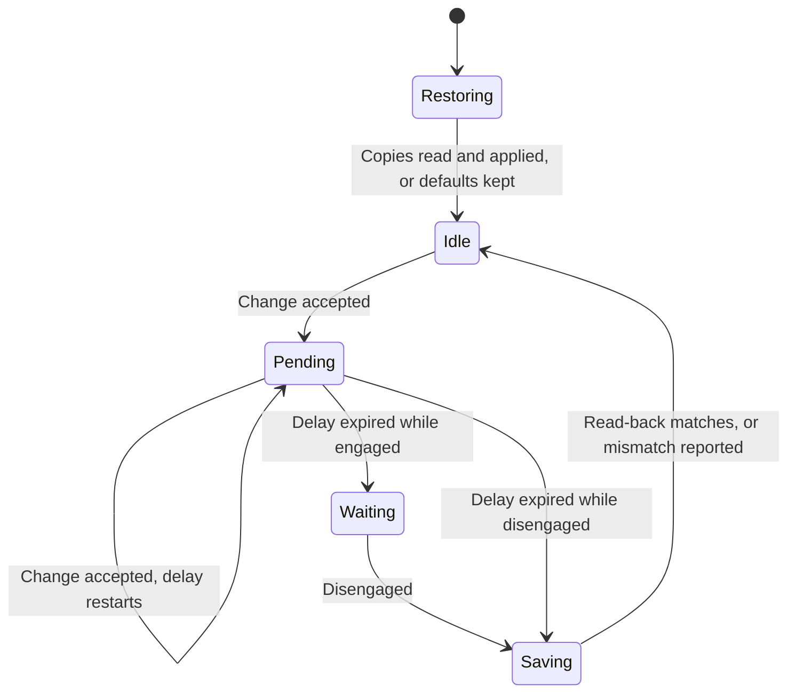
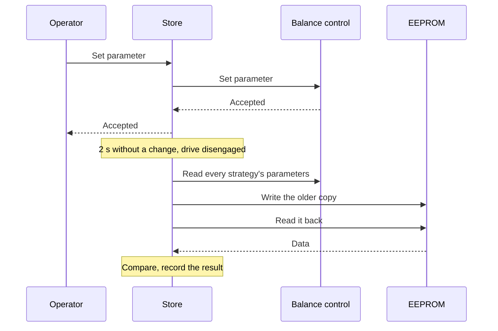

| Field     | Value                     |
|-----------|---------------------------|
| Title     | Tuning Persistence Design |
| Type      | design                    |
| Status    | draft                     |
| Version   | 0.2.0                     |
| Component | persistence               |
| Date      | 2026-11-25                |

> Keeps the selected control strategy and the parameters of every strategy across a reset
> (REQ-TUNE-007). The store is an external I2C EEPROM, so no write touches the internal flash
> that the Bluetooth core shares.

---

## Responsibilities

**Is responsible for:**

- Restoring the strategy selection and all strategy parameters at power-on.
- Saving them after the operator changes a selection or a parameter.
- Detecting a torn or corrupt record and falling back to the defaults.
- Reporting the result of the last restore and the last save.

**Is NOT responsible for:**

- Validating parameter values: balance control already rejects out-of-range values.
- Bluetooth bonds: they stay volatile (`ble-service.md`).
- Calibration values such as the IMU axis map or the wheel geometry.

---

## Component Details

### Part A — The record

One record holds the whole tuning state. It names the active strategy and lists each parameter of
each strategy. A parameter is keyed by a 16-bit hash of its strategy name and parameter name, not
by its position. Restore then survives added, removed and reordered parameters: an unknown key is
ignored, and a missing key keeps its default. A stored value that is now out of range is rejected
by balance control and keeps its default too.

| Field           | Size    | Notes                                          |
|-----------------|---------|------------------------------------------------|
| Format version  | 1 byte  | A record with an unknown version is rejected   |
| Active strategy | 2 bytes | Hash of the strategy name                      |
| Entry count     | 1 byte  | At most 16                                     |
| Entries         | 6 bytes | Key hash and IEEE-754 value, one per parameter |

With the two current strategies (16 parameters) a record is 100 bytes. The record store adds its own
header to mark, order and check each copy.

### Part B — Two copies

`services::NvmRecordStore` from embedded-infra-lib keeps the record in two regions (Data Model,
`regionSize`). Its document `docs/NvmRecordStore.md` gives the copy format, the restore and the
save. A valid copy whose record does not decode is reported as corrupt, and the defaults stay in force.

The 24C04 driver runs one operation at a time. Every store on the EEPROM shares one
`infra::ClaimableResource`, which `Main.cpp` owns.

### Part C — When to save

The store saves 2 seconds after the last accepted change, so a burst of tuning writes makes one
EEPROM write. It never writes while the drive is engaged: the save waits until balance control
disengages. A rejected change does not start a save.

The store sees changes because it stands between the operator interfaces and balance control.
The console and the Bluetooth service talk to the store. The store forwards each call to balance
control and notes each accepted selection or parameter change. The safety supervisor still talks
to balance control directly.

### Part D — Access to every strategy

Balance control today exposes the parameters of the active strategy only. Capture and restore need
all strategies, so balance control gains indexed access: the parameter descriptors, the value and
a guarded write for a given strategy. The write applies the same range and engagement checks as
the existing write.

### Part E — Failure is visible

The EEPROM driver does not report bus errors. The store therefore reads back each copy after it
writes it, and treats a mismatch as a failed save. A failed read returns erased data, which the
record store rejects. The store keeps the result of the last restore and the last save. The
console command `store` shows both. A failed save is not retried at once: the next accepted change
starts a new save to the same copy.

---

## Interfaces

### Provided

| Interface       | Purpose                                          | Contract                                                                 |
|-----------------|--------------------------------------------------|--------------------------------------------------------------------------|
| Balance control | The same interface balance control provides      | Forwards every call; schedules a save on each accepted change            |
| Store status    | The result of the last restore and the last save | Restore: restored, defaults, corrupt. Save: none, pending, saved, failed |

### Required

| Interface       | Purpose                                    | Contract                                                 |
|-----------------|--------------------------------------------|----------------------------------------------------------|
| Balance control | Read and write every strategy's parameters | Indexed access by strategy; writes refused while engaged |
| EEPROM role     | Byte-addressed non-volatile storage        | Asynchronous read and write; at least 256 bytes          |
| Timer service   | The save delay                             | One-shot timer                                           |

The EEPROM role is a new platform role. The selected board provides a 24C04 (512 bytes, 16-byte
pages, address 0x50) on I2C3, SCL on PB10 and SDA on PB11. The host board provides 512 bytes of RAM.

---

## Data Model

| Entity        | Field      | Type / Unit | Range   | Notes                                     |
|---------------|------------|-------------|---------|-------------------------------------------|
| Configuration | saveDelay  | seconds     | 2       | Delay after the last accepted change      |
| Configuration | regionSize | bytes       | 128     | One copy; two copies at offsets 0 and 128 |
| Record        | entries    | count       | 0 to 16 | One per parameter of every strategy       |

---

## State Machine

---

## Sequence Diagrams

---

## Constraints & Limitations

| Constraint      | Value / Description                                                                                    |
|-----------------|--------------------------------------------------------------------------------------------------------|
| No writes armed | No EEPROM write starts while the drive is engaged. A save in progress finishes if the drive arms       |
| Write time      | Header and record (Part A): 7 page writes of 5 ms, 35 ms per save, then a read-back; asynchronous      |
| Endurance       | 1 million writes per cell; the save delay keeps tuning far below that                                  |
| Record size     | 16 parameters fit in a 128-byte copy; more parameters stop the firmware with an assertion              |
| No flash        | The store never writes internal flash, so the watchdog limits in `platform-abstraction.md` Part H hold |

---

## Open Questions

| # | Question                                                           | Options                                    | Status |
|---|--------------------------------------------------------------------|--------------------------------------------|--------|
| 1 | Should calibration values share the EEPROM with the tuning record? | Separate region later; one combined record | open   |
