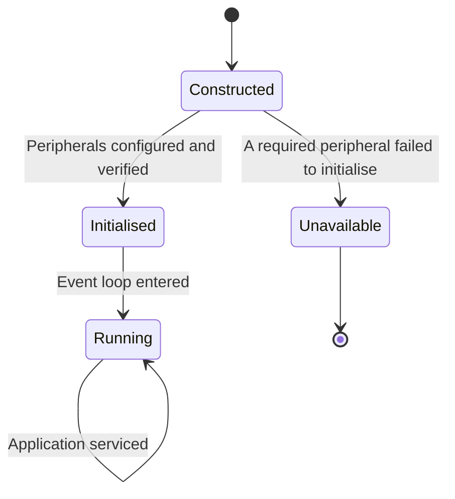
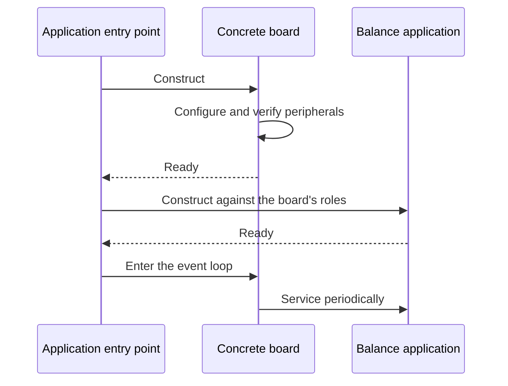
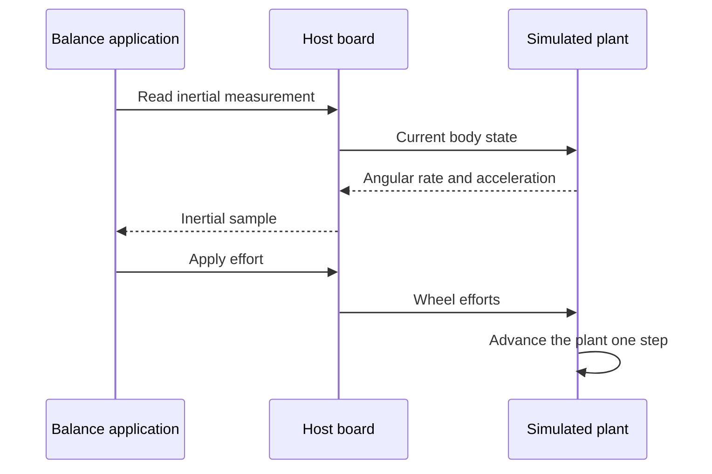
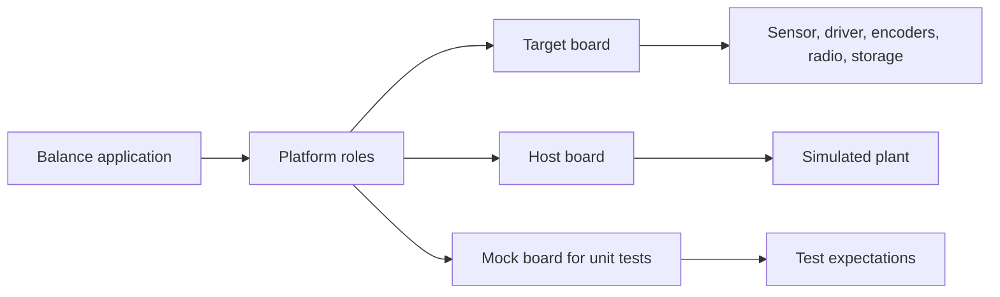

| Field     | Value                       |
|-----------|-----------------------------|
| Title     | Platform Abstraction Design |
| Type      | design                      |
| Status    | draft                       |
| Version   | 0.5.1                       |
| Component | platform-abstraction        |
| Date      | 2026-11-26                  |

> The seam that lets a balancing robot be developed, tested and debugged without a
> balancing robot. Every peripheral the application needs appears here as a role, and
> each board supplies the parts that fill those roles.

---

## Responsibilities

- Declaring the peripheral roles the application requires, in terms of capability rather
  than of any particular part.
- Fixing the conventions — axis orientation, sign of forward wheel motion, effort
  normalisation — that every board implementation must honour.
- Owning the event loop that the application runs on.
- Making the whole control stack constructible on the host, with no target present.

---

## Component Details

### Part A — Roles, not parts

The abstraction names what the application needs without naming how any of it is built:

- a source of body-frame inertial measurements,
- a pair of wheel encoders,
- a two-motor bridge controller,
- a Bluetooth peripheral,
- a parameter store,
- a timebase.

This keeps the inertial part choice an open decision that does not block the estimator, the
controller or their tests.

The existing scaffold seam already carries a status indicator, a serial channel and a tracer for
the blink-and-CLI example. Those stay. A status LED and a diagnostic trace channel remain useful
on a robot. Removing them would break the worked example before the robot's own components exist
to replace it.

### Part B — Conventions are part of the contract

An interface that gets the sign of a wheel wrong compiles perfectly and falls over. The
abstraction therefore fixes, as a contract every implementation must meet:

- the body-frame axis convention for inertial measurements, and the sense of positive pitch;
- that forward robot motion produces a positive displacement on *both* wheels, despite
  their mirrored mounting;
- that effort is normalised and signed, with the sign selecting direction;
- that the timebase is monotonic and that measured intervals, not nominal ones, are what
  callers receive.

These are stated once here rather than rediscovered per board. The body frame, which the first
bullet makes binding, is:

| Axis | Direction |
|------|-----------|
| x    | Forward   |
| y    | Left      |
| z    | Up        |

The frame is right-handed, and the accelerometer reports the gravity vector. At rest and upright
the z axis therefore reads about -9.81 m/s². Positive pitch is nose-up about y. This follows from
the accelerometer model in the [attitude estimation theory](../theory/attitude-estimation.md),
which infers pitch as `atan2(-a_x, -a_z)`. Mapping a particular part's axes onto these is the
board's job, not the application's.

### Part C — The host implementation

The host board is not a stub that returns zeros. It is the substrate for testing. A simulated
plant can drive the inertial and encoder roles from the efforts the controller commands. That
closes the loop entirely in software. It makes the specification scenarios runnable off-target
once step definitions exist. For this reason the abstraction expresses the plant-facing roles in
terms the host can synthesise.

### Part D — Construction and injection

A board is constructed first. The application is constructed against it and holds references
for its lifetime. Nothing is looked up globally and nothing is discovered at run time. The
dependency graph is therefore visible at the construction site, and every component can take a
test double instead.

### Part E — The counter budget is an architectural constraint

The target has few hardware counters that can decode an encoder or drive the bridges. Only one
of them has four independent outputs and a hardware stop input. The motor driver's four bridge
inputs take that one. Both motors then switch in phase, and a single stop input releases every
bridge input in hardware. Two counters with encoder decoding remain for the wheels. One of them
has no per-phase polarity setting. The left wheel is the unmirrored one, so it takes that counter
and needs no inversion. Its 16-bit counter is ample for the configured encoder resolution.

The serial buses are just as constrained. The target has two fast serial buses. The motor driver
gets one of them for configuration and read-back. The inertial sensor gets the other, with a
separate data-ready line. The reservation matters. The motor driver's configuration channel is
the only other thing on the board that needs a bus. Spending its bus on the sensor would leave it
nowhere to go.

This is a board-level allocation, not part of the abstraction. The roles above say nothing about
counters or buses, and a board with more of them is free to spend them differently. It is
recorded here because it is the constraint that shaped three component designs. The reference
board's allocation is in its [platform README](../../targets/platform_implementations/st/README.md).

### Part F — Failure is expressible

Peripherals fail. Roles that can fail say so in their results, not by returning a plausible
value:

- an inertial read reports that it failed,
- a driver configuration read-back reports a mismatch,
- a parameter store reports that it is absent.

The application treats these as first-class outcomes. That is only possible if the abstraction
admits them.

### Part G — The Bluetooth role starts late

The radio is the one role that is not ready when the board is constructed. On the target the
Bluetooth stack runs on a second core. That core boots and reports back some time after the
first core is running. The role is therefore started, not constructed. The application asks the
board to start the radio under a given device name. The board hands back the peripheral once the
stack is up. Nothing else waits for it, and a board without a radio simply never hands it back.

The peripheral is the library's own Bluetooth abstractions and nothing board-specific: GAP and a
GATT server for the robot's service. The GATT server reports the attribute MTU the client
negotiates, so the board needs no link observer of its own.

On the target the second core runs the vendor's full Bluetooth stack. It is flashed separately
from the application. The board's notes list the image and address.

### Part H — The watchdog

The watchdog is a board property, not a role. No application component uses it, so the
abstraction has no role for it. The target board runs its event loop on a dispatcher that supervises
itself. The window watchdog's early-warning interrupt refreshes the watchdog while the loop
makes progress. When one event runs for longer than the stall limit, the board resets the part.

| Quantity                       | Value      | Source                                                |
|--------------------------------|------------|-------------------------------------------------------|
| Watchdog clock                 | 488 Hz     | Bus clock divided by 4096 and a prescaler of 32       |
| Early-warning period           | 129 ms     | 63 watchdog ticks                                     |
| Early-warning service deadline | 2 ms       | One tick: the part resets if the interrupt runs later |
| Reset after an event starts    | 129–258 ms | The first warning in an event counts as progress      |

An event that finishes within 129 ms never causes a reset. The limit is far above the longest
event the firmware runs, and short enough to stop a stalled robot from driving on.

Two conditions follow from the service deadline:

- No code may mask interrupts for longer than 2 ms.
- No flash erase may stall the main core for longer than 2 ms. Today nothing writes flash: the
  Bluetooth stack keeps its bond data in SRAM. A later flash writer must refresh the watchdog
  around each erase.

The watchdog starts while the board is constructed, before the event loop runs. From then on,
only the early-warning interrupt keeps it alive. The watchdog driver also sets the interrupt
priority grouping. On the target, with four priority bits, that grouping and the one the vendor
start-up code sets give the same preemption.

A reset leaves the motor driver's inputs, sleep and reset lines undriven. The driver's pull-downs
are expected to keep the bridges released until the application starts again in its initial mode
(REQ-SAFE-009). Verify this on the robot.

The host board has no watchdog.

---

## Interfaces

### Provided

| Interface                 | Purpose                                                         | Contract                                                                                                                     |
|---------------------------|-----------------------------------------------------------------|------------------------------------------------------------------------------------------------------------------------------|
| Inertial measurement role | Body-frame angular rate and acceleration                        | Fixed axis convention; failure and staleness reported explicitly, never substituted                                          |
| Wheel encoder role        | Signed counts for both wheels, and the counter resolution       | Lossless across counter wrap; forward motion positive on both wheels; index events are not yet provided — see REQ-ODOM-005   |
| Motor driver role         | The two motor bridges, plus notification when the driver faults | Tri-state reachable without a healthy control loop; a fault is reported, never polled                                        |
| Motor bridge role         | Two duty cycles, one per driver input                           | Both inputs low releases the bridge; the encoding is the driver's, not the board's                                           |
| Bluetooth peripheral role | Advertising, connection, pairing, GATT database                 | Started asynchronously under a device name; exposes GAP and GATT server; connection loss and MTU changes observable          |
| Parameter store role      | Byte-addressed non-volatile storage for the tuning record       | Asynchronous read and write; at least 256 bytes; the target board fits a small serial EEPROM ([persistence](persistence.md)) |
| Timebase role             | Periodic scheduling and interval measurement                    | Monotonic; reports the measured interval                                                                                     |
| Status indicator role     | Visible heartbeat and mode indication                           | Never on a timing-critical path                                                                                              |
| Trace role                | Diagnostic text output                                          | May be a no-op on a board without a channel; never blocks the control loop                                                   |
| Event loop                | Hand control to the platform's scheduler                        | Does not return on the target                                                                                                |

### Required

| Interface         | Purpose                              | Contract                                                              |
|-------------------|--------------------------------------|-----------------------------------------------------------------------|
| Board peripherals | Whatever the concrete board provides | Supplied by each board implementation; not visible to the application |

---

## Data Model

| Entity          | Field        | Type / Unit                           | Range             | Notes                                                              |
|-----------------|--------------|---------------------------------------|-------------------|--------------------------------------------------------------------|
| Inertial sample | angular rate | radians per second, three axes        | part-dependent    | Body frame, fixed convention                                       |
| Inertial sample | acceleration | metres per second squared, three axes | part-dependent    | Body frame, fixed convention                                       |
| Inertial sample | valid        | boolean                               | true or false     | False on transfer failure                                          |
| Encoder sample  | counts       | signed counts per wheel               | full signed range | Accumulated across wrap                                            |
| Encoder sample  | index seen   | boolean per wheel                     | true or false     | Advisory; never resets counts. Not yet provided — see REQ-ODOM-005 |
| Effort command  | value        | normalised effort                     | -1.0 to 1.0       | Sign selects direction                                             |
| Timebase        | interval     | microseconds                          | monotonic         | Measured, not nominal                                              |

---

## State Machine

Board lifecycle, identical on every platform.

---

## Sequence Diagrams

Composition at startup — the only place the concrete board is visible.

The same application against a simulated plant on the host.

---

## Block Diagram

---

## Constraints & Limitations

| Constraint              | Value / Description                                                                                                              |
|-------------------------|----------------------------------------------------------------------------------------------------------------------------------|
| No allocation           | Roles are constructed once at startup; no allocation after that                                                                  |
| No global state         | Dependencies are injected at construction; nothing is looked up globally                                                         |
| Conventions are binding | Axis orientation, wheel sign and effort normalisation are part of the contract, not per-board choices                            |
| Capability, not parts   | A role exists only if more than one board could plausibly provide it                                                             |
| Timing is explicit      | Roles with real-time obligations state them; the abstraction does not hide latency                                               |
| Host fidelity           | The host board can reproduce interfaces and timing, but not analogue reality. Passing on the host is necessary, never sufficient |
| Scaffold roles retained | The status indicator, serial channel and tracer remain until the robot's own components replace the worked example               |

---

## Decisions

| # | Decision                                                                                 | Options                                                               | Status                                                                                                                                                                                                                                                                   |
|---|------------------------------------------------------------------------------------------|-----------------------------------------------------------------------|--------------------------------------------------------------------------------------------------------------------------------------------------------------------------------------------------------------------------------------------------------------------------|
| 1 | Does the inertial role expose raw samples or a configured sample rate the board owns?    | Application-driven polling; board-driven sample callback              | decided — a board-driven callback. The part asserts data-ready at its own cadence, so the board owns the rate and timestamps each sample as the driver delivers it, one bus transfer after the edge; polling would report the poller's interval rather than the sensor's |
| 2 | Should the simulated plant live behind the host board or beside it as a separate tool?   | Behind the host board; separate simulator composed at the entry point | open                                                                                                                                                                                                                                                                     |
| 3 | Is the parameter store a distinct role or part of the board's general configuration?     | Distinct role; folded into board configuration                        | decided — a distinct EEPROM role ([persistence](persistence.md))                                                                                                                                                                                                         |
| 4 | Should a second board be defined now to prove the abstraction is not shaped by one part? | Defer until the first board works; define early as a design check     | open                                                                                                                                                                                                                                                                     |
