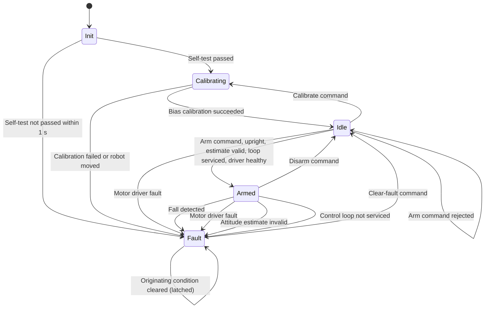
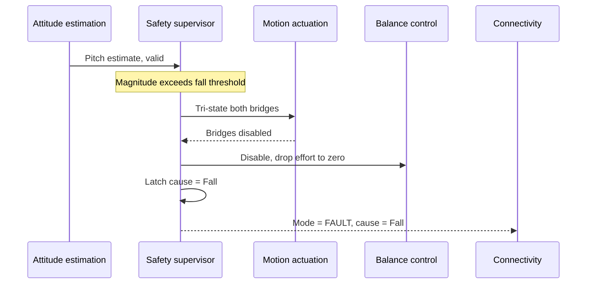
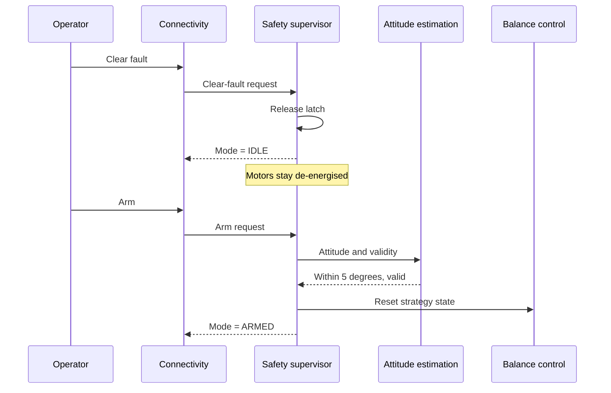

| Field     | Value                    |
|-----------|--------------------------|
| Title     | Safety Supervisor Design |
| Type      | design                   |
| Status    | draft                    |
| Version   | 0.5.1                    |
| Component | safety-supervisor        |
| Date      | 2026-11-26               |

> The supervisor owns the single decision that can hurt someone: whether the motors may
> be energised. Everything else in the firmware is advisory to it.

---

## Responsibilities

- Owning the operating mode and permitting only defined transitions between modes.
- Deciding whether the drive may be energised, and forcing it to a safe state otherwise.
- Running the start-up self-test and gyroscope bias calibration, and later recalibration on
  operator request.
- Detecting the four disarm conditions:
  - A fall.
  - A motor driver fault.
  - Loss of a valid attitude estimate.
  - A control loop that is no longer being serviced.
- Latching a fault together with its cause, and holding it until the operator clears it.
- Enforcing the preconditions on arming, and on strategy and parameter changes.
- Resetting the active control strategy on every transition into ARMED.

---

## Component Details

### Part A — Mode ownership

A single authoritative mode variable, written only by the supervisor. Every other
component reads it and none may change it. Transition requests arrive from the
connectivity component (arm, disarm, clear fault) or from internal detectors. The supervisor
checks each against the transition table for the active mode and rejects it if not permitted.
Rejection is silent to the drive: a refused arm request leaves the system exactly as it
was.

The balance and outer stages run only while ARMED. The supervisor sees every balance iteration before
the balance stage does. An iteration that detects a disarm condition thus never reaches the balance
stage. It engages balance control on entry to ARMED and disengages it on every exit.
Operator motion commands are subject to the same permission: they are refused unless ARMED.

### Part B — Fall detection

The supervisor compares the estimated pitch magnitude against the fall threshold on every
balance iteration. Crossing the threshold is not a recoverable event. The robot has
already lost the ability to catch itself. The response is thus an immediate tri-state and FAULT,
not a controller intervention. The threshold is deliberately well outside the recoverable
envelope — a 30-degree lean is the controller's problem; 35 degrees is the supervisor's.

### Part C — Fault aggregation and latching

Faults arrive from four independent sources and are normalised into a single latched
cause. Latching is the important property: once the robot has fallen, returning it to
upright must not silently re-enable the motors under the operator's hands. The latch
clears only on an explicit clear-fault command, and clearing the latch moves the system to
IDLE — never directly to ARMED. Arming is always a separate, deliberate second act.

### Part D — Liveness monitoring

The supervisor is fed by the balance loop, so a loop that stops running would otherwise
freeze the supervisor along with it. A timebase-driven check independent of the balance
loop counts missed services; three consecutive misses is a fault. The check runs at the
balance period, 2 ms, so a stalled loop is caught within 6 ms. This is the one detector that
must keep working when the rest of the control stack has stopped.

The check runs on the event loop, so it cannot see a stalled event loop. The target's watchdog
covers that case: it resets the target ([platform abstraction](platform-abstraction.md), Part H;
REQ-SAFE-010).

A motor driver fault latches FAULT from IDLE as well as from ARMED. A driver that has reported a
fault must not be energised by the next arm request.

### Part E — Arming preconditions

Arming requires all of these:

- A near-upright attitude.
- A valid estimate.
- A loop that is being serviced.
- A healthy, configured motor driver.

The validity condition matters as much as the angle. An estimator that has not converged can report
upright while being wrong. The liveness condition matters for the same reason. The last estimate of a
stalled loop can read upright long after it stopped being true. On a successful arm the supervisor
resets the active strategy's internal state. Behaviour thus never depends on history from a previous
session.

### Part F — Self-test and calibration

After reset the supervisor waits in INIT for the self-test. The self-test needs all of these:

- The motor driver reports its configuration verified.
- Inertial sensing has delivered at least one sample.
- The start-up condition holds.

Any of them failing to happen within 1 second is a self-test fault. The start-up
condition is the restore of the calibration record ([calibration](calibration.md), Part D). Bias
calibration thus always runs with the restored axis map. A missing or corrupt record also ends the
restore, and the defaults stay in force. On success the supervisor starts gyroscope bias
calibration and waits in CALIBRATING. A failed calibration, typically because the robot moved, is
a calibration fault. From IDLE the operator may request a recalibration, which re-enters
CALIBRATING. Clearing a calibration fault returns to IDLE. From IDLE, arming is refused until a
calibration succeeds, because the uncalibrated estimate is invalid.

---

## Interfaces

### Provided

| Interface                 | Purpose                                                       | Contract                                                                                                                                     |
|---------------------------|---------------------------------------------------------------|----------------------------------------------------------------------------------------------------------------------------------------------|
| Mode query                | Report the active operating mode                              | Exactly one mode is active at any instant; readable from any context without blocking                                                        |
| Mode command              | Request arm, disarm, clear-fault or calibrate                 | Checked against the transition table; a rejected request changes nothing. Arming additionally requires upright attitude and a valid estimate |
| Fault report              | Report the latched fault cause                                | Valid whenever the mode is FAULT; persists until the fault is cleared                                                                        |
| Drive permission          | Tell actuation and control whether the drive may be energised | Deasserted before the mode leaves ARMED, never after                                                                                         |
| Loop service notification | Accept the balance loop's periodic liveness signal            | Absence for 3 consecutive periods is a fault                                                                                                 |

### Required

| Interface           | Purpose                                                              | Contract                                                                         |
|---------------------|----------------------------------------------------------------------|----------------------------------------------------------------------------------|
| Attitude estimate   | Detect falls and check arming preconditions                          | Carries an explicit validity indication; the supervisor treats invalid as unsafe |
| Estimate quality    | Judge the estimate                                                   | The supervisor only consumes the validity flag; it estimates no attitude         |
| Motor driver health | Observe driver-reported faults                                       | An asserted fault is latched even if it clears immediately afterwards            |
| Drive disable       | Force both bridges to tri-state                                      | Must succeed without a healthy control loop; tri-state, never brake              |
| Motion actuation    | Produce the tri-state at the hardware level                          | The supervisor requests a tri-state; actuation decides how                       |
| Balance control     | Compute the effort commands                                          | The supervisor computes no effort                                                |
| Connectivity        | Carry mode and fault cause to the operator                           | The supervisor publishes them; it does not talk to the operator                  |
| Strategy lifecycle  | Engage balance control on arming, disengage on every exit from ARMED | Engagement completes before the drive is permitted                               |
| Calibration         | Start and observe gyroscope bias calibration                         | Reports calibrating, calibrated or failed                                        |
| Timebase            | Drive liveness monitoring                                            | Independent of the balance loop it supervises                                    |
| Start-up condition  | Hold the self-test until the saved calibration is in force           | Reports ready once; stays ready                                                  |

---

## State Machine

Every edge into Fault tri-states both bridges as its first action. There is deliberately no
edge from Fault directly to Armed.

---

## Sequence Diagrams

Fall detection — the path that must meet the 20 ms budget.

Recovery — two deliberate operator acts, never one.

---

## Data Model

| Entity           | Field            | Type / Unit  | Range                                                                                    | Notes                                              |
|------------------|------------------|--------------|------------------------------------------------------------------------------------------|----------------------------------------------------|
| Supervisor state | mode             | enumeration  | INIT, CALIBRATING, IDLE, ARMED, FAULT                                                    | Exactly one active                                 |
| Supervisor state | latchedCause     | enumeration  | None, Fall, DriverFault, EstimateInvalid, LoopStalled, SelfTestFailed, CalibrationFailed | Meaningful only in FAULT                           |
| Supervisor state | missedServices   | count        | 0 to 3                                                                                   | Reset on each loop service; 3 triggers a fault     |
| Configuration    | fallThreshold    | degrees      | 35                                                                                       | Magnitude of pitch from upright                    |
| Configuration    | armWindow        | degrees      | 5                                                                                        | Maximum tilt permitted when arming                 |
| Configuration    | tristateDeadline | milliseconds | 20                                                                                       | Budget from detection to bridges disabled          |
| Configuration    | servicePeriod    | milliseconds | 2                                                                                        | Liveness check period, equal to the balance period |
| Configuration    | selfTestDeadline | milliseconds | 1000                                                                                     | Time allowed from reset to a passed self-test      |

---

## Constraints & Limitations

| Constraint              | Value / Description                                                                                                                         |
|-------------------------|---------------------------------------------------------------------------------------------------------------------------------------------|
| Fall-to-tristate budget | 20 ms from the estimate crossing the threshold to both bridges disabled                                                                     |
| Liveness independence   | The liveness monitor must not be driven by the loop it supervises                                                                           |
| Disable path            | Reaching a safe state must not depend on the control loop, the estimator or the link                                                        |
| No automatic recovery   | There is no path from FAULT to ARMED without two separate operator commands                                                                 |
| Flat ground only        | The fall threshold assumes a level surface; a sloped surface narrows the effective recoverable envelope                                     |
| Detection scope         | The supervisor detects falls, not the causes of falls. A slipping wheel or a drained battery is visible only through its effect on attitude |

---

## Decisions

| # | Decision                                                                                                     | Options                                               | Status                                                                                        |
|---|--------------------------------------------------------------------------------------------------------------|-------------------------------------------------------|-----------------------------------------------------------------------------------------------|
| 1 | Should the fall threshold scale with measured wheel velocity, since a moving robot has less recovery margin? | Fixed threshold; velocity-dependent threshold         | open                                                                                          |
| 2 | Should a hardware watchdog back the software liveness monitor?                                               | Software only; add the target's watchdog              | decided: the target's watchdog resets a stalled event loop (platform abstraction, Part H)       |
| 3 | Should battery voltage be a supervised fault source?                                                         | Out of scope this revision; add an undervoltage fault | open                                                                                          |
| 4 | Should repeated falls within a short window require a longer operator acknowledgement?                       | Treat every fall identically; escalate on repetition  | deferred                                                                                      |
