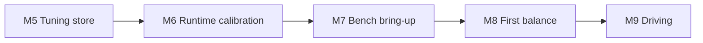

| Field     | Value      |
|-----------|------------|
| Title     | Roadmap    |
| Type      | roadmap    |
| Status    | draft      |
| Version   | 0.3.1      |
| Component | system     |
| Date      | 2026-11-26 |

> The path from the current firmware to a robot that balances and drives. Each milestone links to
> the document that owns its detail. Update this page when a milestone changes state.

---

## Milestones

| #  | Milestone                    | State   | Where it is defined                                       |
|----|------------------------------|---------|-----------------------------------------------------------|
| M1 | Component firmware           | done    | `architecture/system.md`                                  |
| M2 | Scaffold removed             | done    | —                                                         |
| M3 | Safety scenarios on the host | done    | `integration_tests/README.md`, `use-cases/safety.feature` |
| M4 | Hardware watchdog            | done    | `design/platform-abstraction.md`, Part H; REQ-SAFE-010    |
| M5 | Tuning kept across a reset   | done    | `design/persistence.md`; REQ-TUNE-007                     |
| M6 | Runtime calibration          | done    | `design/calibration.md`                                   |
| M7 | Bench bring-up               | current | This page, [M7](#m7--bench-bring-up)                      |
| M8 | First balance                | planned | This page, [M8](#m8--first-balance)                       |
| M9 | Driving                      | planned | This page, [M9](#m9--driving)                             |

---

## M6 — Runtime calibration

| Step | Repository         | Change                                                                 | State |
|------|--------------------|------------------------------------------------------------------------|-------|
| 1    | this               | Inertial sensing and attitude estimation setters                       | done  |
| 2    | this               | Motion actuation and wheel odometry setters                            | done  |
| 3    | embedded-infra-lib | `services::NvmRecordStore`: two copies, save delay, read-back, restore | done  |
| 4    | this               | Tuning store on `NvmRecordStore`, with a shared EEPROM claim           | done  |
| 5    | this               | The calibration component, its store and the `cal` command             | done  |

The record store holds an opaque payload, so it is not tied to the tuning or calibration format.
It uses an `NvmRegion`, so it also works on flash.

## M7 — Bench bring-up

Work on the robot, with the wheels off the ground.

| Step | Action                                                                                | Exit condition                                          |
|------|---------------------------------------------------------------------------------------|---------------------------------------------------------|
| 1    | Fit the 24C04 on PB10/PB11; tune a value; reset                                       | `store` reports `restore restored`                      |
| 2    | Stall the event loop for more than 300 ms                                             | The part resets; both bridges stay released             |
| 3    | Tilt the robot; set the axis map with `cal axes`                                      | `attitude` shows positive pitch for a forward tilt      |
| 4    | Drive each wheel slowly; set `cal motor` and `cal encoder`                            | Forward effort gives forward motion and positive counts |
| 5    | Measure the wheels; set `cal wheel`                                                   | `odom` distance matches a measured roll                 |
| 6    | Hold the robot still and upright; set `cal still`, run `calibrate`, set `cal upright` | `attitude` reads 0 ± 0.5° upright                       |
| 7    | Arm with the outer loop gains at zero; read `loop`                                    | Period and jitter meet REQ-RT-001 to REQ-RT-003         |

## M8 — First balance

| Step | Action                                                                     | Exit condition                    |
|------|----------------------------------------------------------------------------|-----------------------------------|
| 1    | Run `tools/lqr_design` with the measured masses, inertias and wheel torque | A first gain set to start from    |
| 2    | Tune the inner pitch loop with the robot on a tether                       | The robot holds upright for 60 s  |
| 3    | Raise the outer velocity loop gains                                        | The robot holds its position      |
| 4    | Check a fall on the robot                                                  | FAULT within 20 ms (REQ-SAFE-002) |

## M9 — Driving

| Step | Action                                         | Exit condition                               |
|------|------------------------------------------------|----------------------------------------------|
| 1    | Drive with `move` on the console               | The robot follows velocity and yaw setpoints |
| 2    | Drive over Bluetooth (`design/ble-service.md`) | The checks in the ST board README pass       |

---

## Toolboxes

Generic algorithms moved to the shared toolboxes, one pull request per step.

| Step | Repository            | Change                                                                         | State |
|------|-----------------------|--------------------------------------------------------------------------------|-------|
| T1   | robotics-toolbox-cpp  | Linearised wheeled inverted pendulum model (`theory/pendulum-dynamics.md`)     | done  |
| T2   | this                  | Add robotics-toolbox; `tools/lqr_design` prints LQR gains from measured values | done  |
| T3   | this                  | Wheel odometry uses `robotics::DifferentialDrive`                              | done  |
| T4   | numerical-toolbox-cpp | PID with continuous gains; gravity-vector tilt and trust                       | done  |
| T5   | this                  | Use the T4 algorithms in place of the local copies                             | done  |

The wrapped counter delta stays in wheel odometry: it is integer arithmetic, and numerical-toolbox is
float only.

## Backlog

Not needed for a first balance. Each item links to where it is recorded.

| Item                                         | Where it is recorded                      |
|----------------------------------------------|-------------------------------------------|
| Encoder index events (REQ-ODOM-005)          | `design/wheel-odometry.md`, decision 1    |
| Motor current rating (REQ-DRIVE-005)         | `use-cases/safety.feature`                |
| Battery voltage supervision                  | `design/safety-supervisor.md`, decision 3 |
| Motor current measurement                    | `design/motion-actuation.md`, decision 3  |
| Persistent Bluetooth bonds                   | `design/ble-service.md`                   |
| More scenarios on the host                   | `use-cases/README.md`                     |
| Rate limiter with a variable time step       | Not designed yet                          |
| Signed axis permutation in numerical-toolbox | Not designed yet                          |
